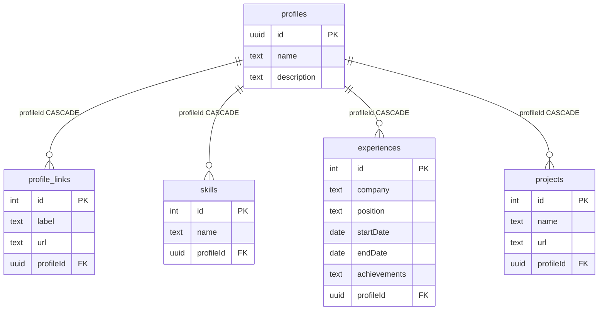

# Цифровая визитка (GraphQL API)

Backend-приложение на **NestJS**, которое отдаёт профиль специалиста через **GraphQL** (Apollo Sandbox на `/graphql`). Данные хранятся в **PostgreSQL**, доступ — через **Prisma**. Запуск «с нуля» — через **Docker Compose**.

## Быстрый старт

```bash
docker compose up --build
```

Откройте [http://localhost:3000/graphql](http://localhost:3000/graphql) и выполните запрос:

```graphql
query {
  profile {
    name
    description
    links {
      label
      url
    }
    skills {
      name
    }
    experience {
      company
      position
      period
      achievements
    }
    projects {
      name
      url
    }
  }
}
```

### Локальная разработка (без Docker)

1. Поднимите PostgreSQL и задайте `DATABASE_URL` (см. `.env.example`).
2. `npm install`
3. `npm run start:dev`

При каждом старте приложения выполняются миграции и seed (см. раздел «Инициализация БД»).

## Персонализация

Отредактируйте `prisma/seed.ts` — имя, описание, ссылки, навыки, опыт и проекты. Seed идемпотентен: при перезапуске данные профиля пересоздаются.

## Архитектурные решения

### Слои и разделение ответственности

| Слой | Назначение |
|------|------------|
| **GraphQL** (`modules/profile/graphql`) | Контракт API, резолверы, маппинг сущностей БД в типы GraphQL |
| **Domain / application** (`ProfileService`) | Бизнес-правила уровня приложения (например, получение единственного профиля) |
| **Data access** (`ProfileRepository`) | Запросы к БД через Prisma, без знания GraphQL |
| **Infrastructure** (`PrismaModule`, DataLoader) | Подключение к БД, batch-загрузка для GraphQL |

GraphQL-резолвер не обращается к Prisma напрямую: корневой `profile` идёт через сервис, вложенные поля — через DataLoader + репозиторий. Так проще тестировать и менять источник данных.

### Схема БД



### Модель данных

Один профиль (singleton) с первичным ключом **UUID v7** и связанные сущности: ссылки, навыки, опыт, проекты. Идентификатор генерируется при seed (`uuid` v7); API находит профиль через `findFirst()`. Для визитки этого достаточно; при росте требований схему можно расширить без смены GraphQL-контракта за счёт field resolvers.

Период работы в API отдаётся вычисляемым полем `period` (форматирование в `profile.mapper.ts`), даты хранятся в БД как `startDate` / `endDate`.

### GraphQL и оптимизация запросов к БД

Вложенные поля (`skills`, `experience`, `projects`, `links`) реализованы **field resolvers**, а не одним большим `include` на корневом запросе. Клиент запрашивает только нужные поля — лишние таблицы не читаются.

Для каждого HTTP-запроса создаётся новый набор **DataLoader** (контекст GraphQL). Loaders батчат обращения по `profileId` (`WHERE profileId IN (...)`), что устраняет проблему N+1 при расширении API (несколько профилей, списки и т.д.).

### Инициализация БД

Порядок при старте (`main.ts`):

1. Ожидание доступности PostgreSQL.
2. `prisma migrate deploy` — применение миграций из репозитория.
3. `prisma db seed` — заполнение демо-данными.

Так один и тот же сценарий работает локально и в контейнере после `docker compose up`.

### Docker

- **db** — PostgreSQL 16 с healthcheck.
- **app** — multi-stage образ: сборка TypeScript, production-зависимости, `prisma generate`.

`DATABASE_URL` для контейнера задаётся в `docker-compose.yml`.

### Технологический стек

- **Git** — версионирование миграций Prisma и кода.
- **TypeScript** — строгая типизация от GraphQL до Prisma.
- **Node.js + NestJS** — модульная структура, DI, GraphQL code-first.
- **Prisma** — миграции, типобезопасный клиент, seed.
- **GraphQL + Apollo Server** — introspection и встроенный Apollo Sandbox.
- **Docker** — воспроизводимый запуск БД и приложения.

## Структура проекта

```
src/
  main.ts                          # старт, migrate + seed
  app.module.ts
  infrastructure/
    prisma/
    dataloader/                      # DataLoader + GraphQL context
  modules/
    profile/
      profile.repository.ts
      profile.service.ts
      graphql/
        profile.model.ts
        profile.mapper.ts
        profile.resolver.ts
prisma/
  schema.prisma
  seed.ts
  migrations/
```

## Скрипты

| Команда | Описание |
|---------|----------|
| `npm run start:dev` | Nest в режиме watch |
| `npm run build` | Сборка в `dist/` |
| `npm run start:prod` | Production-запуск (миграции/seed — при старте через `main.ts`, используйте `node dist/main`) |
| `npm run prisma:migrate` | Только миграции |
| `npm run prisma:seed` | Только seed |
